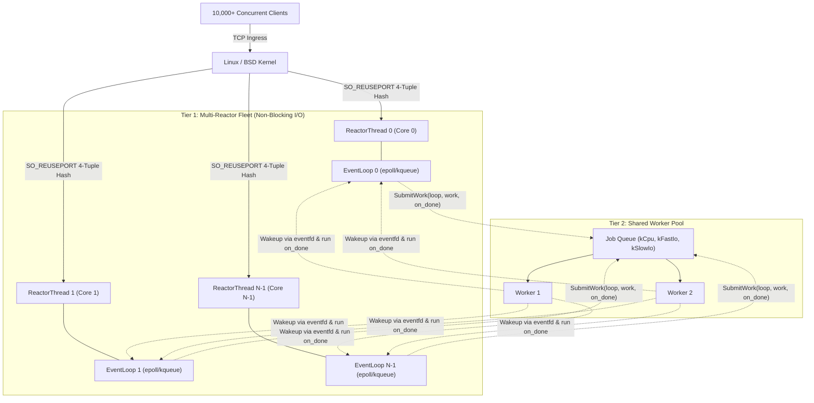

# mini_reactor

A modern, high-performance C++20 network engine implementing the **Multi-Reactor pattern with a Shared Thread Pool**, inspired by the core event-driven architectures of **Envoy Proxy**, **NGINX**, **Node.js (`libuv`)**, and **Redis (`ae.c`)**.

`mini_reactor` scales non-blocking socket I/O linearly across all CPU cores using the Linux/BSD kernel's `SO_REUSEPORT` load balancing, handling tens of thousands of concurrent TCP connections with **zero user-space locks** on network buffers.

---

## 1. High-Level Architecture

`mini_reactor` decouples network socket multiplexing from heavy computation using a **2-Tier Concurrency Model ($1 + N + M$)**:

```
                       10,000+ Concurrent TCP Clients
                                      │
                       [Kernel SO_REUSEPORT Balancing]
                                      ▼
┌────────────────────────────────────────────────────────────────────────┐
│                   Tier 1: Multi-Reactor I/O Fleet                      │
│                                                                        │
│  ┌───────────────────────┐           ┌───────────────────────┐         │
│  │ Reactor Thread 0      │           │ Reactor Thread N-1    │         │
│  │ • Pinned to Core 0    │           │ • Pinned to Core N-1  │         │
│  │ • Dedicated EventLoop │   • • •   │ • Dedicated EventLoop │         │
│  │ • epoll / kqueue      │           │ • epoll / kqueue      │         │
│  │ • Owns ~1,250 conns   │           │ • Owns ~1,250 conns   │         │
│  └───────────┬───────────┘           └───────────┬───────────┘         │
└──────────────┼───────────────────────────────────┼─────────────────────┘
               │                                   │
               │ Fast Non-Blocking (PING / Writes) │
               │                                   │
               ▼ (Offload CPU / Blocking Disk)     ▼
┌────────────────────────────────────────────────────────────────────────┐
│                     Tier 2: Shared Thread Pool                         │
│                                                                        │
│  Shared Job Queue (Thread-Safe std::deque + condition_variable)        │
│  ┌──────────────────┐  ┌──────────────────┐  ┌──────────────────────┐  │
│  │  Worker Thread 1 │  │  Worker Thread 2 │  │  Worker Thread M     │  │
│  └─────────┬────────┘  └─────────┬────────┘  └──────────┬───────────┘  │
│            └─────────────────────┴──────────────────────┘              │
│                 Signals originating loop via wakeup_fd_                │
│                 (Handoff on_done callback back to loop)                 │
└────────────────────────────────────────────────────────────────────────┘
```



### Core Architecture Highlights

* **Tier 1: Multi-Reactor I/O Fleet (`ReactorThread` & `EventLoop`)**:
  - $N = \text{hardware\_concurrency()}$ independent reactor threads run their own non-blocking polling loops (`epoll` on Linux, `kqueue` on macOS/BSD).
  - **`SO_REUSEPORT` Ingress Balancing**: Each reactor opens its own listening socket on the target port. The kernel hashes incoming 4-tuples and distributes connections evenly with zero user-space locking.
  - **Share-Nothing Concurrency**: Connections permanently belong to their accepting reactor. Buffers (`read_buf_`, `write_buf_`) are manipulated solely on that CPU core's hardware cache, requiring zero mutex locks.
* **Tier 2: Shared Thread Pool (`ThreadPool`)**:
  - Slow operations (such as disk I/O, database lookups, or heavy cryptographic hashing) are offloaded to background threads.
  - Workers complete `work()` independently and hand the `on_done()` callback back to the originating loop via `wakeup_fd_`.

---

## 2. Threading Model & Math

$$\text{Total System OS Threads} = 1 \text{ (Main Thread)} + N \text{ (Reactor Threads)} + M \text{ (ThreadPool Workers)}$$

| Component | Count | Description |
| :--- | :---: | :--- |
| **Main Process Thread** | $1$ | Manages configuration, initializes thread pools, orchestrates reactor threads, and handles OS signals (`SIGINT`/`SIGTERM`). |
| **Reactor Threads** | $N$ | Non-blocking I/O workers (default: hardware concurrency, e.g. 8). |
| **Worker Threads** | $M$ | Background threads executing offloaded heavy tasks (default: 4). |
| **Client Connections** | **0 Threads** | **Zero threads!** 10,000+ connections are represented purely by non-blocking file descriptors multiplexed inside `epoll`/`kqueue`. |

> **Example on an 8-Core CPU**:
> $1 \text{ (Main)} + 8 \text{ (Reactors)} + 4 \text{ (Workers)} = \mathbf{13 \text{ OS Threads}}$
> These **13 OS threads** comfortably service **100,000+ concurrent clients**, compared to thread-per-connection architectures that would consume 80+ GB of RAM purely in thread stack allocations.

See [docs/threading_model.md](docs/threading_model.md) for full memory calculations and thread breakdown.

---

## 3. Project Structure (Pitchfork Standard)

```
event-loop/
├── CMakeLists.txt              # Target-based CMake configuration (C++20)
├── Makefile                    # Standardized wrapper for build, test, and reset
│
├── include/                    # PUBLIC API (Headers exposed to consumers)
│   └── mini_reactor/           # Subdirectory namespacing
│       ├── server.hpp          # Top-level multi-reactor server orchestrator
│       ├── reactor_thread.hpp  # RAII worker thread encapsulating 1 loop + 1 listener
│       ├── connection.hpp      # Non-blocking TCP connection state machine
│       ├── event_loop.hpp      # Event loop engine (I/O multiplexing + Timers)
│       └── thread_pool.hpp     # Multi-worker thread pool (CPU vs Slow I/O)
│
├── src/                        # PRIVATE IMPLEMENTATION (.cpp + private headers)
│   ├── server.cpp              # Server implementation
│   ├── reactor_thread.cpp      # ReactorThread lifecycle & accept loop
│   ├── connection.cpp          # Buffered non-blocking read/write & framing
│   ├── event_loop.cpp          # EventLoop logic (NextTimeout, dispatching)
│   ├── thread_pool.cpp         # WorkerLoop & job dispatch
│   ├── fd_guard.hpp            # Move-only RAII UniqueFd descriptor guard
│   ├── poller.hpp              # OS Poller interface
│   └── poller/                 # Platform Poller backends
│       ├── poller_kqueue.hpp   # macOS & FreeBSD kqueue backend
│       ├── poller_kqueue.cpp
│       ├── poller_epoll.hpp    # Linux epoll backend
│       └── poller_epoll.cpp
│
├── examples/                   # Runnable sample applications
│   ├── echo_server.cpp         # Low-level EventLoop & ThreadPool echo server
│   └── high_level_server.cpp   # Multi-reactor Server fleet with signal handling
│
├── tests/                      # Comprehensive unit test suites (100% passing)
│   ├── event_loop_test.cpp     # EventLoop, Timers, UniqueFd, high FD growth
│   ├── connection_test.cpp     # Connection framing, backpressure, EOF, half-close
│   ├── reactor_thread_test.cpp # Live TCP loopback client connect/echo exchange
│   └── thread_pool_test.cpp    # CPU handoff, slow I/O, worker distribution
│
├── scripts/                    # Maintenance & automation scripts
│   └── reset.sh                # Deep clean build artifacts, caches, and temp files
│
└── docs/                       # Technical architecture documentation
    ├── README.md               # Documentation directory index
    ├── architecture.md         # In-depth design rationale & Redis/libuv/Envoy maps
    ├── threading_model.md      # Thread count breakdown & memory analysis
    ├── multi_reactor_flow.md   # SO_REUSEPORT load balancing topology
    └── request_flow.md         # Request sequence diagrams & state machine
```

---

## 4. Build, Test & Reset

### Prerequisites
* C++20 compliant compiler (`clang++` $\ge$ 16 or `g++` $\ge$ 11)
* CMake $\ge$ 3.20

### Quick Start with Makefile

```bash
# 1. Build library, examples, and unit tests
make build

# 2. Run all unit tests via CTest
make test

# 3. Launch the multi-reactor example server
make run-server

# 4. Clean build directory
make clean

# 5. Deep clean & reset (cleans build/, caches, compile_commands.json, orphan .o files)
make reset

# 6. Deep clean and rebuild fresh from scratch
make re
```

### Building via CMake Directly

```bash
# Configure
cmake -B build

# Build in parallel
cmake --build build -j

# Execute test suite
ctest --test-dir build --output-on-failure
```

---

## 5. Test Suite Verification

`mini_reactor` features a comprehensive unit test suite with 100% pass rate:

| Suite | Component | Key Tests |
| :--- | :--- | :--- |
| **`EventLoopTest`** | `EventLoop`, `UniqueFd`, `Poller` | RAII move semantics, readable I/O notification, min-heap timer priority queue, timer lazy cancellation, dynamic FD array resizing (high FD=100), writable notifications, dynamic mask modification, 0ms immediate timers, concurrent sockets. |
| **`ConnectionTest`** | `Connection` | Immediate fast-path write bypass, protocol framing (`PING` $\to$ `ECHO_OK`), fragmented packet assembly (`"PI"` + `"NG\n"`), peer EOF detection, backpressure buffering under saturated kernel socket buffers, `kHalfClosed` pending write flush, explicit close. |
| **`ReactorThreadTest`** | `ReactorThread` | Background `std::jthread` lifecycle, live loopback TCP client connect/echo exchange (`127.0.0.1`), atomic `connection_count` accounting, concurrent TCP clients. |
| **`ThreadPoolTest`** | `ThreadPool` | RAII worker shutdown, CPU computation & loop handoff (`worker_tid != loop_tid`), non-blocking slow I/O verification, concurrent thread distribution, `WorkKind` starvation prevention, high-throughput stress queueing. |

---

## 6. Running the Examples

### 1. High-Level Multi-Reactor Server
Spawns an $N$-reactor fleet across all CPU cores with graceful `Ctrl+C` (`SIGINT`) shutdown:

```bash
./build/high_level_server
```

In another terminal, connect using `nc` or `telnet`:
```bash
echo "PING" | nc localhost 8080
# Output: ECHO_OK
```

### 2. Echo Server with Worker Offloading
Demonstrates low-level `EventLoop` socket handling and offloading tasks to `ThreadPool` background workers:

```bash
./build/echo_server
```

---

## 7. Deep-Dive Documentation

For detailed architectural analysis and design comparisons with Redis, libuv, and Envoy:

* [docs/architecture.md](docs/architecture.md) — Comprehensive engineering rationale, comparative source map, and design decisions.
* [docs/threading_model.md](docs/threading_model.md) — Detailed thread inventory, memory overhead analysis, and `ReactorThread` lifecycle.
* [docs/multi_reactor_flow.md](docs/multi_reactor_flow.md) — `SO_REUSEPORT` kernel ingress load balancing and share-nothing multi-reactor flow.
* [docs/request_flow.md](docs/request_flow.md) — Sequence diagrams tracing request handoff, fast vs slow path, and connection state machine.
* [docs/README.md](docs/README.md) — Technical documentation index.
