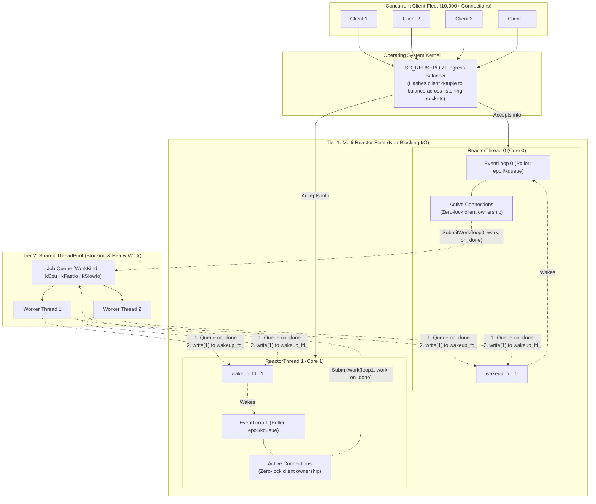

# mini_reactor Architecture & Design Rationale

`mini_reactor` is an educational, production-structured C++20 network engine designed to handle tens of thousands of concurrent TCP connections efficiently using a non-blocking, multi-reactor pattern. It mirrors the core event-driven concurrency primitives found underneath **Redis (`ae.c`)**, **Node.js (`libuv`)**, and **Envoy Proxy**.

---

## 1. High-Level System Architecture

`mini_reactor` uses a **2-Tier Concurrency Model ($1 + N + M$)**:
* **Tier 1 (Reactors)**: $N$ isolated EventLoops (1 per CPU core) running non-blocking I/O (`epoll`/`kqueue`).
* **Tier 2 (Worker Pool)**: $M$ shared worker threads executing heavy CPU tasks and slow/blocking I/O.



---

## 2. Comparative Reference Source Map

Every core abstraction in `mini_reactor` directly maps to industry-standard implementations in Redis, libuv, and Envoy:

| Design Concept | Industry Reference | Source File | Key Functions / Structs | Architectural Role |
| :--- | :--- | :--- | :--- | :--- |
| **Reactor Core & Flat Array Indexing** | **Redis** | `src/ae.c`, `src/ae.h` | `aeEventLoop`, `aeCreateFileEvent`, `aeProcessEvents` | Flat array indexed by raw `fd` rather than hash map; separation of registered events and fired event scratchpads. |
| **Timer Processing** | **Redis** | `src/ae.c` | `usUntilEarliestTimer`, `processTimeEvents` | Compute earliest deadline, clamp poller timeout, fire due timer callbacks sequentially. |
| **Poller Backend Abstraction** | **Redis** | `src/ae_epoll.c`, `src/ae_kqueue.c` | `aeApiPoll`, `aeApiAddEvent` | Thin OS abstraction wrapping Linux `epoll` and BSD/macOS `kqueue`. |
| **Non-blocking Event Loop Run** | **libuv** | `src/unix/core.c` | `uv_run` | Continuous loop: compute timeout $\to$ poll kernel $\to$ dispatch FDs $\to$ run timers. |
| **Cross-Thread Wakeup** | **libuv** | `src/unix/async.c` | `uv_async_send`, `uv__async_io` | Signal event loop from background threads via `eventfd` / self-pipe to trigger `on_done` callbacks. |
| **Task Classification & Worker Pool** | **libuv** | `src/threadpool.c` | `uv__work_submit`, `worker` | Differentiate CPU tasks from slow I/O tasks (`uv__work_kind`) to prevent pool starvation. |
| **Per-Thread Reactor & Worker Model** | **Envoy** | `source/server/worker_impl.cc` | `WorkerImpl` | 1:1 binding of event loop to hardware core; complete memory isolation per reactor thread. |
| **Buffered I/O & Backpressure** | **Envoy** | `source/common/network/connection_impl.cc` | `ConnectionImpl::onWriteReady`, `ConnectionImpl::close` | User-space send buffers, backpressure re-arming (`EPOLLOUT`/`kWritable`), half-close flushing. |

---

## 3. Key Engineering Decisions & Rationale

### Decision 1: Flat Array for FD Callbacks vs. `std::unordered_map`
* **Choice**: `std::vector<FdEvent>` indexed directly by `fd`.
* **Rationale**: Sockets in Unix are small, dense integers assigned sequentially by the kernel.
  - A hash map incurs hash computation overhead, pointer chasing, and potential hash collision buckets for every single I/O event.
  - A flat vector provides direct $O(1)$ random access (`callbacks_[fd]`). When an FD exceeds capacity, the vector doubles geometrically (mirroring Redis `ae.c`'s `newnevents = newnevents * 2`).

### Decision 2: Min-Heap with Lazy Cancellation for Timers
* **Choice**: `std::priority_queue` storing `(TimerId, deadline, callback)` paired with a `std::unordered_set<TimerId> cancelled_` lookup.
* **Rationale**:
  - Redis searches an unsorted linked list for timers because it only tracks a handful of internal cron events.
  - In a general-purpose network server where clients schedule timeouts, a min-heap provides $O(\log K)$ insertion and $O(1)$ earliest-deadline lookup.
  - Because `std::priority_queue` does not support random element removal without rebuilding the heap, cancelled timers are recorded in a fast hash set and skipped lazily upon maturity.

### Decision 3: RAII for OS Descriptors (`UniqueFd`)
* **Choice**: Move-only RAII wrapper [`UniqueFd`](file:///Users/bmathnguyen/Documents/Code/Cpp-Codebase/event-loop/src/fd_guard.hpp).
* **Rationale**: Eliminates descriptor leaks on early returns or error paths.
  - C projects like Redis enforce manual `close()` calls on every exit path.
  - In C++20, wrapping raw descriptors in a move-only type guarantees zero file descriptor leaks while transferring socket ownership seamlessly across layers.

### Decision 4: Kernel-Level Ingress Distribution (`SO_REUSEPORT`)
* **Choice**: Each `ReactorThread` opens its own listening socket on the target port with `SO_REUSEPORT`.
* **Rationale**:
  - Traditional multi-threaded servers have a single listening socket and multiple threads competing on `accept()`, causing kernel lock contention (the "thundering herd" problem).
  - With `SO_REUSEPORT`, the Linux kernel hashes the incoming 4-tuple (client IP, client port, server IP, server port) directly in hardware/kernel space, distributing connections evenly across reactor threads with **zero user-space locks**.

### Decision 5: Non-Blocking Backpressure & Half-Close
* **Choice**: `Connection` manages `read_buf_` and `write_buf_` with `kWritable` dynamic registration.
* **Rationale**:
  - Sockets must never block on `write()`. If the OS kernel send buffer is full, `write()` returns `EAGAIN`/`EWOULDBLOCK`.
  - `Connection::Write` transmits as much as the kernel accepts; unwritten bytes are stored in `write_buf_`, and `kWritable` is dynamically armed on the poller.
  - Once the peer drains the socket, `OnWritable` flushes the buffered data and automatically unregisters `kWritable` to prevent CPU spinning.

---

## 4. Class Design & Component Skeletons

```
┌────────────────────────────────────────────────────────┐
│                        Server                          │
│ - Owns ServerConfig                                    │
│ - Owns Shared ThreadPool (M worker threads)            │
│ - Owns std::vector<std::unique_ptr<ReactorThread>> (N) │
└───────────────────────────┬────────────────────────────┘
                            │ 1:N
                            ▼
┌────────────────────────────────────────────────────────┐
│                     ReactorThread                      │
│ - Owns std::jthread                                    │
│ - Owns UniqueFd listen_fd_ (SO_REUSEPORT on port)      │
│ - Owns EventLoop loop_                                 │
│ - Owns std::unordered_map<int, shared_ptr<Connection>> │
└───────────────────────────┬────────────────────────────┘
                            │ 1:1
                            ▼
┌────────────────────────────────────────────────────────┐
│                       EventLoop                        │
│ - Owns std::unique_ptr<Poller> (epoll / kqueue)        │
│ - Owns std::vector<FdEvent> callbacks_                 │
│ - Owns TimerQueue timers_ & cancelled set              │
│ - NextTimeout() / ProcessTimers() / Run() / Stop()     │
└───────────────────────────┬────────────────────────────┘
                            │ 1:N
                            ▼
┌────────────────────────────────────────────────────────┐
│                      Connection                        │
│ - Owns UniqueFd fd_ (non-blocking client TCP socket)   │
│ - Holds EventLoop& reference                           │
│ - std::vector<std::byte> read_buf_ & write_buf_        │
│ - ConnState: kOpen, kHalfClosed, kClosed               │
│ - OnReadable() / OnWritable() / Write() / Close()      │
└────────────────────────────────────────────────────────┘
```

---

## 5. Poller Backend Architecture (epoll vs. kqueue)

`mini_reactor` supports both Linux and macOS/BSD through a unified interface [`Poller`](file:///Users/bmathnguyen/Documents/Code/Cpp-Codebase/event-loop/src/poller.hpp):

```
                        ┌──────────────────┐
                        │      Poller      │
                        │    Interface     │
                        └────────┬─────────┘
                                 │
                 ┌───────────────┴───────────────┐
                 ▼                               ▼
       ┌───────────────────┐           ┌───────────────────┐
       │   Poller (epoll)  │           │  Poller (kqueue)  │
       │  Linux (edge/lvl) │           │   macOS / FreeBSD │
       │  src/poller/      │           │   src/poller/     │
       │  poller_epoll.cpp │           │  poller_kqueue.cpp│
       └───────────────────┘           └───────────────────┘
```

* **Linux**: Uses `epoll_create1(EPOLL_CLOEXEC)`, `epoll_ctl(EPOLL_CTL_ADD/MOD/DEL)`, and `epoll_wait`.
* **macOS / BSD**: Uses `kqueue()`, `EV_SET`, and `kevent()` with `EV_RECEIPT` for batch registration and non-blocking timeout handling.
