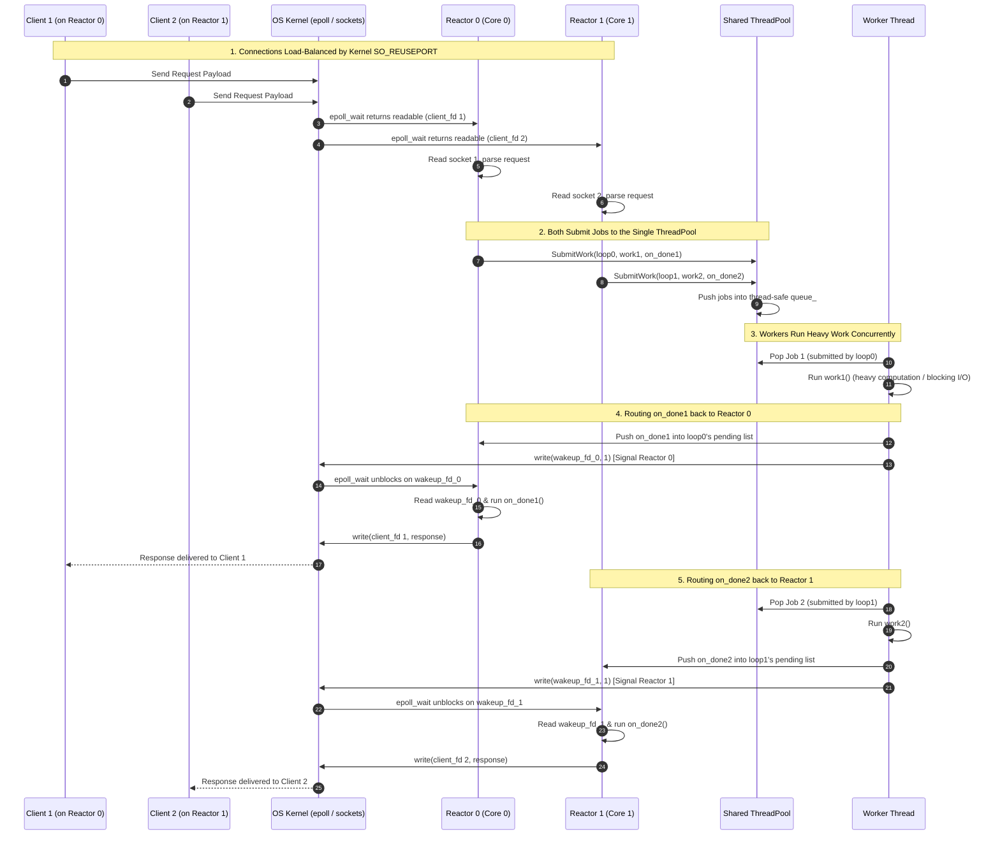

# Multi-Reactor Architecture & Shared ThreadPool

This document explains:
1. **Why we need multiple event loops** alongside a thread pool.
2. **How multiple event loops work together** without race conditions or performance bottlenecks.
3. **The full diagram flow** showing client connections, kernel distribution, shared thread pool dispatch, and wakeup handoff.

> [!NOTE]
> For a full breakdown of thread counts (formula, comparison with thread-per-connection, and why client connections do not have threads), see [threading_model.md](file:///Users/bmathnguyen/Documents/Code/Cpp-Codebase/event-loop/docs/threading_model.md).


---

## 1. Why Do We Need Multiple Event Loops?

A common question is: *If we already have a Thread Pool to offload heavy work, why isn't one Event Loop enough?*

### The Single-Loop Bottleneck
A single event loop thread runs on **exactly one CPU core**. Even if heavy tasks are offloaded to background threads, that single event loop is still responsible for:
* Handling every `epoll_wait()` syscall.
* Calling `accept4()` for every incoming TCP connection.
* Reading every incoming packet (`read`/`recv`) from every socket into memory.
* Parsing HTTP headers, framing protocol packets, and running state machines.
* Serializing responses and calling `write`/`send` to the kernel.

On a modern multi-core machine (e.g. 8, 16, or 64 cores) with a 10Gbps+ network link:
* A single core running an event loop will max out at **100% CPU utilization** purely doing syscalls, socket I/O, and packet parsing (capping throughput at ~50k–100k req/sec).
* The remaining cores sit idle at **0% utilization**.
* **Result:** A single event loop leaves the rest of the machine wasted.

### The Solution: Multi-Reactor (1 EventLoop per Core)
By launching $N$ reactor threads (where $N = \text{number of CPU cores}$):
* Each core runs its own `EventLoop`.
* Socket I/O and protocol parsing scale **linearly** across all CPU cores.
* 8 cores = $8\times$ network throughput.

### The 2-Tier Concurrency Model

| Tier | Role | Thread Model |
| :--- | :--- | :--- |
| **Tier 1: Event Loops (Reactors)** | High-throughput, non-blocking I/O (epoll, socket read/write, protocol parsing). | Exactly 1 loop per CPU core. Never blocks or sleeps. |
| **Tier 2: Shared ThreadPool** | Slow, blocking, or CPU-intensive tasks (disk file read/write, crypto/hashing, DNS queries). | Shared worker threads across all reactors. |

---

## 2. How Do Multiple Event Loops Work Together?

In high-performance networking (used by NGINX, Envoy, and Netty), multiple event loops work together using the **"Share-Nothing"** architecture:

### 1. Ingress Load Balancing via `SO_REUSEPORT`
* Instead of having a single listening socket and threads fighting to `accept()` (which causes kernel lock contention or "thundering herd"), **each reactor thread creates its own listening socket** bound to the same server port using the `SO_REUSEPORT` socket option.
* The **Linux kernel network stack** automatically hashes incoming connections (using the 4-tuple: client IP, client port, server IP, server port) and distributes them evenly across the listening sockets.
* **No user-space locks** are needed to distribute connections.

### 2. Share-Nothing Connection Ownership
* When Reactor 0 accepts a connection, that connection permanently belongs to Reactor 0.
* Reactor 1 never reads, writes, or locks Reactor 0's connections.
* **Zero mutexes** are needed on socket buffers (`read_buf_`, `write_buf_`), and data stays pinned in the L1/L2 cache of each core.

### 3. Coordinating on Shared Heavy Work (The Shared ThreadPool)
* When any connection on any reactor requires blocking or CPU-heavy work, it calls:
  ```cpp
  pool.SubmitWork(loop, work, on_done);
  ```
* The `ThreadPool` is a single instance shared across all reactors.
* The worker thread runs `work()`. When finished, it needs to hand `on_done()` back to the **originating reactor**.
* Each `EventLoop` has its own `wakeup_fd_` (`eventfd`). The worker thread pushes `on_done` into that loop's pending queue and writes 1 byte to that loop's `wakeup_fd_`.
* That loop's `epoll_wait` wakes up, executes `on_done`, and writes the response back to the client on its own thread.

---

## 3. Architecture & Topology Diagram

```mermaid
flowchart TB
    subgraph Clients["Incoming Client Connections"]
        C1["Client 1"]
        C2["Client 2"]
        C3["Client 3"]
        C4["Client 4"]
    end

    subgraph Kernel["Linux Kernel Network Stack"]
        REUSE["SO_REUSEPORT Load Balancer<br/>(Hashes client IP:port to distribute connections)"]
    end

    C1 --> REUSE
    C2 --> REUSE
    C3 --> REUSE
    C4 --> REUSE

    subgraph Reactor0["Reactor Thread 0 (Pinned to CPU Core 0)"]
        EL0["EventLoop 0 (epoll)"]
        WFD0["wakeup_fd_ 0 (eventfd)"]
        CM0["Connections Map 0<br/>(Owns Client 1 & 4)"]
        WFD0 -.->|"Registered in"| EL0
        EL0 --- CM0
    end

    subgraph Reactor1["Reactor Thread 1 (Pinned to CPU Core 1)"]
        EL1["EventLoop 1 (epoll)"]
        WFD1["wakeup_fd_ 1 (eventfd)"]
        CM1["Connections Map 1<br/>(Owns Client 2 & 3)"]
        WFD1 -.->|"Registered in"| EL1
        EL1 --- CM1
    end

    REUSE -->|accept() on listen_fd_0| EL0
    REUSE -->|accept() on listen_fd_1| EL1

    subgraph SharedPool["Shared ThreadPool (Floating across CPU Cores)"]
        JQ[("Shared Job Queue<br/>Job: {work, on_done, &eventloop}")]
        W1["Worker Thread 1"]
        W2["Worker Thread 2"]
        JQ --> W1
        JQ --> W2
    end

    %% Submitting work
    CM0 -.->|"SubmitWork(loop0, work, on_done)"| JQ
    CM1 -.->|"SubmitWork(loop1, work, on_done)"| JQ

    %% Notifying back
    W1 ==>|"1. Append on_done<br/>2. write(1) to wakeup_fd_0"| WFD0
    W2 ==>|"1. Append on_done<br/>2. write(1) to wakeup_fd_1"| WFD1

    classDef client fill:#3b82f6,stroke:#1d4ed8,color:#fff;
    classDef kernel fill:#374151,stroke:#1f2937,color:#fff;
    classDef reactor fill:#1e3a8a,stroke:#3b82f6,color:#fff;
    classDef pool fill:#14532d,stroke:#22c55e,color:#fff;

    class C1,C2,C3,C4 client;
    class REUSE kernel;
    class EL0,EL1,CM0,CM1,WFD0,WFD1 reactor;
    class JQ,W1,W2 pool;
```

---

## 4. End-to-End Sequence Diagram

This sequence traces **Client 1** connected to **Reactor 0** and **Client 2** connected to **Reactor 1**, showing how both reactors concurrently use the single **Shared ThreadPool**:



---

## 5. Summary of Roles

```
┌────────────────────────────────────────────────────────┐
│                      Linux Kernel                      │
│     SO_REUSEPORT balances TCP connections by 4-tuple   │
└───────────────┬────────────────────────┬───────────────┘
                │                        │
       Connection 1, 4          Connection 2, 3
                ▼                        ▼
┌────────────────────────┐      ┌────────────────────────┐
│ Reactor Thread 0       │      │ Reactor Thread 1       │
│ - Pinned to Core 0     │      │ - Pinned to Core 1     │
│ - EventLoop 0          │      │ - EventLoop 1          │
│ - Owns Connection 1, 4 │      │ - Owns Connection 2, 3 │
│ - Owns wakeup_fd_ 0    │      │ - Owns wakeup_fd_ 1    │
└───────────────┬────────┘      └────────┬───────────────┘
                │                        │
                │  SubmitWork(loop, ...) │
                └───────────┬────────────┘
                            ▼
      ┌──────────────────────────────────────────┐
      │          Shared ThreadPool               │
      │ - Shared job queue (mutex + cv)          │
      │ - Worker threads run blocking/CPU work   │
      │ - When done: signals originating loop's  │
      │   wakeup_fd_                             │
      └──────────────────────────────────────────┘
```
