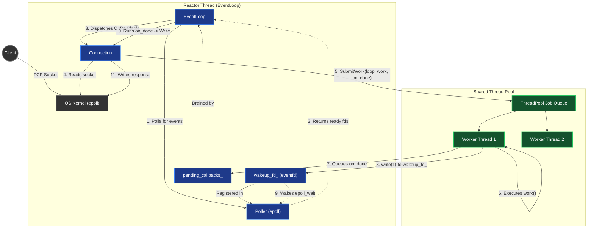
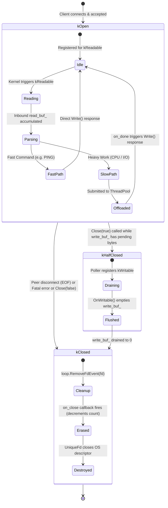

# Request Flow & ThreadPool Dispatch Architecture

This document illustrates how a client request flows through the `mini_reactor` architecture when using the **Shared ThreadPool** design. For the full multi-reactor system topology with `SO_REUSEPORT`, see [multi_reactor_flow.md](file:///Users/bmathnguyen/Documents/Code/Cpp-Codebase/event-loop/docs/multi_reactor_flow.md).

---

## 1. Sequence Diagram: Lifecycle of a Request

This sequence diagram shows method calls across threads. 
* The **EventLoop thread** handles non-blocking socket I/O, `epoll_wait`, and owns `wakeup_fd_`.
* The **Worker thread** runs blocking/CPU-heavy logic (`work`), then queues `on_done` into the originating loop and signals `wakeup_fd_`.

```mermaid
sequenceDiagram
    autonumber
    participant Client
    participant OS as OS Kernel (epoll)
    participant Loop as EventLoop Thread
    participant Conn as Connection
    participant Pool as Shared ThreadPool
    participant Worker as Worker Thread
    
    %% 1. INCOMING REQUEST
    Client->>OS: Sends Request payload
    OS->>Loop: epoll_wait unblocks (client_fd readable)
    Loop->>Loop: ProcessReadyFdEvents
    
    %% 2. READ & PARSE
    Loop->>Conn: Invokes OnReadable callback
    Conn->>OS: read(client_fd)
    OS-->>Conn: Returns bytes into read_buf_
    Conn->>Conn: Parse request (detects heavy/blocking task)
    
    %% 3. DISPATCH TO SHARED THREAD POOL
    Note over Conn,Pool: Offload slow I/O or heavy CPU
    Conn->>Pool: SubmitWork(loop, work, on_done)
    Pool->>Pool: Push Job{work, on_done, &loop}
    Pool->>Worker: Notify via queue_cv_
    
    %% 4. BACKGROUND EXECUTION
    Note over Worker: Runs independently on worker thread
    Worker->>Worker: Executes work() (no access to loop or socket)
    
    %% 5. HANDOFF BACK TO ORIGINATING LOOP
    Note over Worker,Loop: Handoff on_done to originating EventLoop
    Worker->>Loop: Append on_done to loop's pending_callbacks_
    Worker->>OS: write(loop.wakeup_fd_, 1) to tap loop on shoulder
    
    %% 6. EVENT LOOP WAKEUP
    OS->>Loop: epoll_wait unblocks (wakeup_fd_ readable)
    Loop->>Loop: ProcessReadyFdEvents -> Read wakeup_fd_ (clear counter)
    Loop->>Loop: Drain pending_callbacks_ and execute on_done()
    
    %% 7. RESPONSE DISPATCH
    Note over Loop,Conn: Back on originating EventLoop thread
    Loop->>Conn: on_done calls Connection::Write(response)
    Conn->>Conn: Append response to write_buf_
    Conn->>OS: write(client_fd)
    OS-->>Client: Sends Response
```

---

## 2. Component Flow & Thread Boundaries

This flowchart visualizes the objects and how they cross thread boundaries:



---

## 3. Connection State Machine Diagram

Connections transition through an explicit state machine ([`ConnState`](file:///Users/bmathnguyen/Documents/Code/Cpp-Codebase/event-loop/include/mini_reactor/connection.hpp#L12)):



---

## 4. Fast Path vs. Slow Path Dispatch

| Attribute | Fast Path (e.g. `PING`, cache read) | Slow Path (e.g. `CPU`, heavy compute, disk file) |
| :--- | :--- | :--- |
| **Execution Thread** | Originating Reactor Thread | Background `ThreadPool` Worker Thread |
| **Context Switches** | **Zero** (immediate in-place execution) | 2 context switches (to worker thread, then back to loop) |
| **Thread Overhead** | Nanosecond direct function call | Mutex lock on task queue + condition variable wakeup |
| **Socket Output** | Direct `Connection::Write` in callback | `on_done` callback invoked via `wakeup_fd_` handoff |
| **Backpressure Handling** | If kernel buffer full, arms `kWritable` | If kernel buffer full, arms `kWritable` |

---

## 5. Key Architectural Takeaways
1. **No Data Races on Connections:** Because `Connection::OnReadable`, `Connection::Write`, and the `on_done` callback all execute exclusively on the **Reactor Thread**, you never need a `std::mutex` to protect `read_buf_` or `write_buf_`.
2. **`wakeup_fd_` Lives on the EventLoop:** Each `EventLoop` owns its own `eventfd` registered with its own `epoll`. The worker thread writes a single byte to the *submitting* loop's `wakeup_fd_`, which causes that loop's `epoll_wait` to wake up instantly.
3. **Decoupled Thread Pool:** The `ThreadPool` does not need to know about reactor internals; it simply executes `work()` and delegates `on_done` back to `job.eventloop`.

