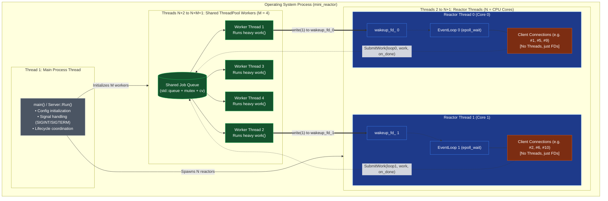

# Threading Model & Thread Count Breakdown

This document provides a comprehensive breakdown of the threading architecture in `mini_reactor`:
1. **Total Thread Count Formula & Inventory Table**
2. **Why Client Connections Do NOT Have Threads (Reactor vs. Thread-per-Connection)**
3. **Why `ReactorThreadMain` is a Separate Function**
4. **Deep Dive into Each Thread Category**
5. **Architectural Thread Map Diagram**

---

## 1. Thread Inventory & Total Count

A common point of confusion in asynchronous network servers is: *“If I have 10,000 connected clients, how many threads are running?”*

In this architecture, **clients do not have threads**.

### Thread Inventory Table

| Component | Number of Threads | Default Value | Role / Responsibility |
| :--- | :--- | :--- | :--- |
| **Main Process Thread** | **$1$** | $1$ | Initializes configuration, launches reactor threads and thread pool, traps OS signals (`SIGINT`/`SIGTERM`), coordinates graceful shutdown. |
| **Reactor Threads** (`ReactorThreadMain`) | **$N$** | `hardware_concurrency()` (e.g. $8$) | Runs the non-blocking `EventLoop` (`epoll`). Accepts incoming TCP connections, performs non-blocking `read`/`write`, parses protocols. |
| **Shared ThreadPool Workers** | **$M$** | $4$ | Executes slow, blocking, or CPU-intensive tasks offloaded by connections. When done, notifies the originating reactor thread via `wakeup_fd_`. |
| **Client Connections** | **$0$** | $0$ (Up to $100,000+$ clients) | **Zero threads!** Each client is represented merely by an integer file descriptor (`fd`) managed inside an `EventLoop`. |

### The Total Thread Formula

$$\text{Total System Threads} = 1 \text{ (Main Thread)} + N \text{ (Reactor Threads)} + M \text{ (ThreadPool Workers)}$$

### Concrete Example: 8-Core Machine with 10,000 Active Clients

Suppose `mini_reactor` runs on an 8-core CPU ($N = 8$) with 4 thread pool workers ($M = 4$):

$$\text{Total OS Threads} = 1 + 8 + 4 = \mathbf{13 \text{ threads}}$$

These **13 OS threads** handle **all 10,000 client connections** concurrently without creating a single extra thread!

---

## 2. Why Client Connections Do NOT Have Threads

To understand why clients do not get threads, compare the **Traditional Thread-per-Connection** model with the **Reactor Event-Driven** model:

```
Traditional Thread-per-Connection (e.g., Apache MPM Worker, Naive Socket Server):
Client 1 ───► [Thread 1] (Blocks on read() 99% of time, doing nothing)
Client 2 ───► [Thread 2] (Blocks on read() 99% of time, doing nothing)
...
Client 10,000 ─► [Thread 10,000] (Requires ~80GB RAM, OS crashes from context switching)

Reactor Pattern (e.g., NGINX, Node.js, Envoy, mini_reactor):
Client 1 ──────┐
Client 2 ──────┼──► [Linux Kernel epoll] ──► [1 Reactor Thread]
...            │    (Wakes up ONLY when        (Runs non-blocking loop,
Client 10,000 ─┘     data is ready)             processes thousands of fds)
```

### The Problems with Thread-per-Connection:
1. **Memory Exhaustion (Stack Overhead):**
   Every OS thread allocates a stack (typically 2MB to 8MB). 10,000 threads $\times$ 8MB = **80 GB of memory** just for empty call stacks!
2. **Context-Switching Thrashing:**
   The OS scheduler must constantly preempt and switch between thousands of threads. The CPU spends more time saving and restoring registers than running application code.
3. **Wasted Resources:**
   Over 99% of network socket time is spent waiting for the client to send a packet over the internet. In a thread-per-connection model, a thread sits blocked in the kernel doing zero work.

### How the Reactor Solves This:
* A socket file descriptor is just an integer in the kernel's file table.
* In non-blocking mode (`O_NONBLOCK`), a single thread can monitor thousands of file descriptors simultaneously using `epoll_wait()`.
* If no client is sending data, the reactor thread sleeps inside `epoll_wait(timeout)`.
* When data arrives on *any* socket, `epoll_wait` wakes up and returns the list of active file descriptors. The reactor reads the available bytes and immediately moves to the next ready descriptor.
* Memory per connection drops from **8 MB (thread stack)** to **a few KB (connection state & buffers)**.

---

## 3. Why Encapsulate Into a Dedicated `ReactorThread` Class?

In [src/server.cpp](file:///Users/bmathnguyen/Documents/Code/Cpp-Codebase/event-loop/src/server.cpp), you see:
```cpp
void Server::Run() {
  for (size_t i = 0; i < config_.n_reactors; ++i) {
    reactors_.emplace_back(
        std::make_unique<ReactorThread>(config_.port, i, global_thread_pool_));
    reactors_.back()->Start();
  }
}
```

There are four key architectural reasons why `ReactorThread` is encapsulated as a dedicated class rather than an ad-hoc thread lambda:

### 1. RAII Lifetime Management (`std::jthread`)
`ReactorThread` owns its worker thread via `std::jthread`. When `Server::Stop()` is invoked (or when the server destructs), `ReactorThread` automatically coordinates stopping the event loop and safely joining the OS thread without dangling pointers or resource leaks.

### 2. Kernel-Level Ingress Distribution (`SO_REUSEPORT`)
Inside [`ReactorThread::SetupClientListeningSocket()`](file:///Users/bmathnguyen/Documents/Code/Cpp-Codebase/event-loop/src/reactor_thread.cpp#L28-L63):
```cpp
listen_fd_ = UniqueFd(socket(AF_INET, SOCK_STREAM, 0));
SetNonBlocking(listen_fd_.get());
int opt = 1;
setsockopt(listen_fd_.get(), SOL_SOCKET, SO_REUSEPORT, &opt, sizeof(opt));
bind(listen_fd_.get(), (sockaddr *)&addr, sizeof(addr));
listen(listen_fd_.get(), SOMAXCONN);
```
* If the main thread created a single `listen_fd`, all reactor threads would have to contend to call `accept()` on the same socket (causing the famous **thundering herd** problem and kernel lock contention).
* Instead, **each `ReactorThread` instance creates its own listening socket** on the same port using `SO_REUSEPORT`.
* The operating system kernel automatically load-balances incoming TCP connections across these separate sockets using a 4-tuple hash (`client_ip`, `client_port`, `server_ip`, `server_port`).

### 3. Share-Nothing Thread Isolation
* Each `ReactorThread` permanently owns its `EventLoop loop_`, its `listen_fd_`, and its active connection map:
  ```cpp
  std::unordered_map<int, std::shared_ptr<Connection>> active_connections_;
  ```
* Because connections belong exclusively to one reactor:
  * **Zero mutexes** are needed to read or write connection buffers (`read_buf_`, `write_buf_`).
  * Connection memory remains hot in that specific CPU core's L1/L2 hardware cache.

### 4. Separation of Responsibilities
* **Main Thread:** Orchestrator. Reads configuration, allocates resources, traps shutdown signals (`SIGINT`/`SIGTERM`), and commands the workers to stop.
* **`ReactorThread`:** Worker. Never blocks on signals or CLI prompts; exclusively executes the non-blocking I/O loop (`EventLoop::Run()`).

---

## 4. Deep Dive into Each Thread Type

### Tier 0: The Main Thread (Quantity: 1)
* **Creation:** Automatically created by the OS when the binary starts.
* **Stack:** Owns the `Server` object instance and `main()`.
* **State when Server is running:** Blocked waiting for an exit signal (e.g. `sigwait()`, `std::jthread::join()`, or a stop condition).
* **Workload:** Negligible (< 0.1% CPU).

### Tier 1: The Reactor Threads (`ReactorThreadMain`, Quantity: $N$)
* **Creation:** Spawned inside `Server::Run()`.
* **Number of Threads:** Typically equals CPU cores ($N = \text{hardware\_concurrency()}$, e.g. 8).
* **State when idle:** Blocked inside the `epoll_wait()` system call waiting for network packets or `wakeup_fd_` interrupts.
* **State when active:**
  1. `accept()` new client sockets assigned by kernel `SO_REUSEPORT`.
  2. Read incoming client bytes into `read_buf_`.
  3. Parse protocol messages (e.g. `PING`, `SLOW_IO`).
  4. Write responses directly to the client socket (for fast tasks).
  5. Offload slow/heavy jobs to the Shared ThreadPool.
  6. Execute `on_done` callbacks when notified by the thread pool and send the final response.

### Tier 2: The Shared ThreadPool Workers (Quantity: $M$)
* **Creation:** Spawned during `ThreadPool` construction.
* **Number of Threads:** Typically 4 to 16 ($M = \text{config.n\_thread\_pool\_workers}$).
* **State when idle:** Blocked inside `std::condition_variable::wait()` waiting for a job in `job_queue_`.
* **State when active:**
  1. Pop a `Job` from the queue.
  2. Execute `work()` (e.g., synchronous file read/write, database call, heavy cryptographic hashing).
  3. Push `on_done` into the originating `EventLoop`'s pending queue.
  4. Write 1 byte to the originating loop's `wakeup_fd_` to wake its `epoll_wait()`.

### The Clients (Quantity: 0 to 100,000+)
* **Number of Threads:** **0**.
* **Representation:** Each client is an instance of `std::shared_ptr<Connection>` containing:
  * Non-blocking socket file descriptor `fd_`.
  * Input buffer `read_buf_`.
  * Output buffer `write_buf_`.
  * State flags (`is_closed_`, `is_busy_`).
* All operations on a client connection happen strictly on its assigned Reactor Thread.

---

## 5. Architectural Thread Map Diagram



---

## 6. Summary Comparison Table

| Property | Thread-per-Connection (Old Apache) | Single Event Loop (Node.js / Redis) | Multi-Reactor + Shared ThreadPool (Our Architecture) |
| :--- | :--- | :--- | :--- |
| **Total Threads for 10k clients** | $10,000+$ threads | $1$ loop thread + small threadpool | **$1 + N + M$** ($\approx 13$ threads) |
| **Memory per 10k clients** | **~80 GB** (stack per thread) | **~50 MB** | **~50 MB** (heap buffers only) |
| **Multi-Core Scaling for Network I/O** | Yes (via OS scheduling) | **No** (stuck on 1 core) | **Yes** (linear scaling across all cores via $N$ reactors) |
| **Blocking Task Safety** | Safe (only affects 1 client) | Dangerous (freezes entire server) | **Safe** (offloaded to Shared ThreadPool, returns via `wakeup_fd_`) |
| **Locking Overhead on Sockets** | High (per-thread synchronization) | None (single-threaded) | **None** (Share-Nothing: each socket owned by 1 reactor) |
